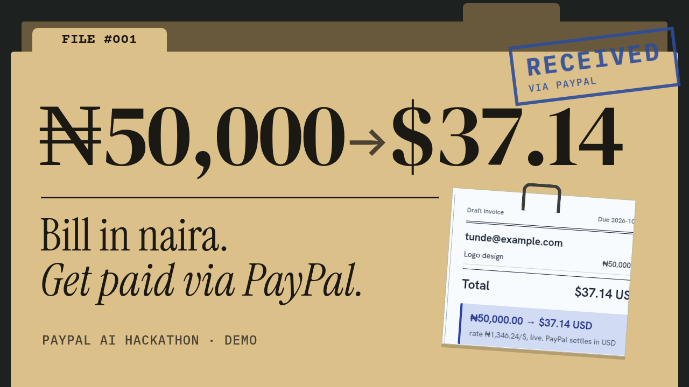
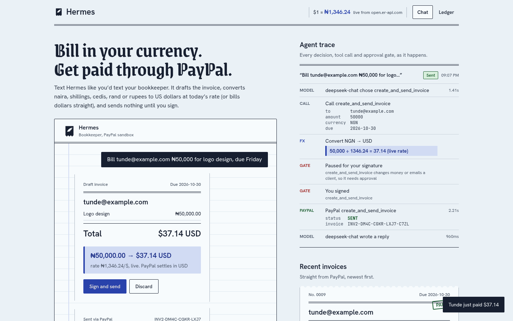
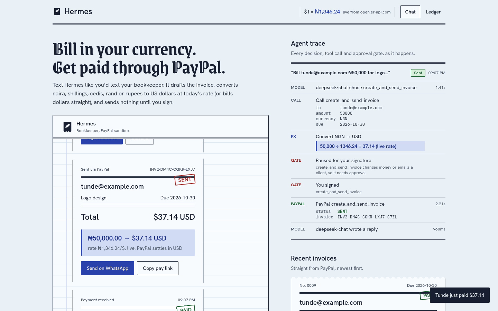
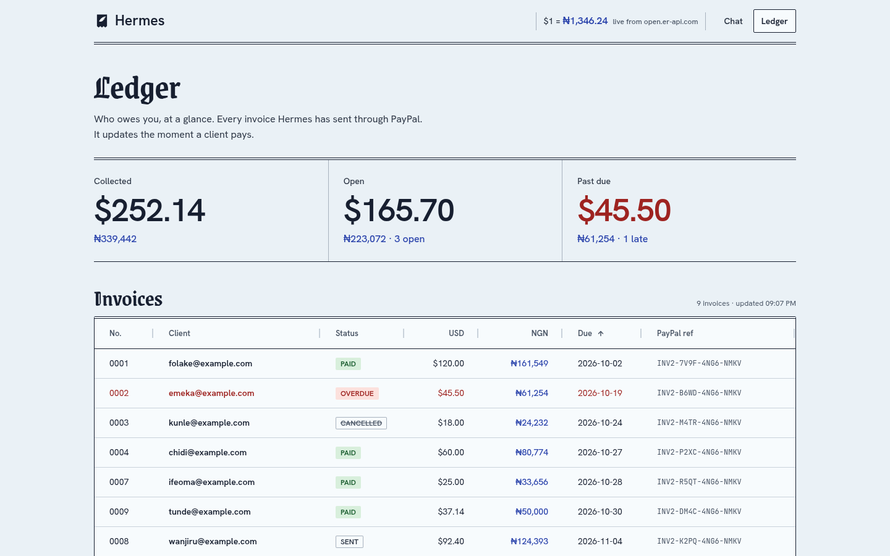
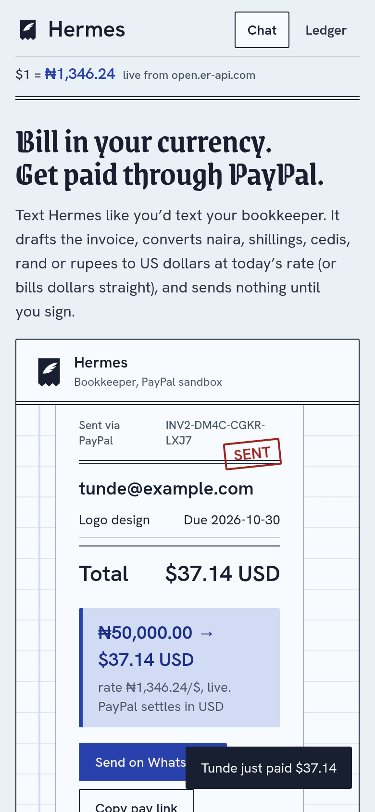

# Hermes Invoice Agent

**Bill in your currency. Get paid through PayPal.**

[](https://youtu.be/v-BYun6aX88)

**Live demo:** https://hermes-invoice-agent.onrender.com (PayPal sandbox, no sign-in, add `?demo` for sample data)
**Demo video:** https://youtu.be/v-BYun6aX88

Chat-first invoicing agent for freelancers and small businesses. Type
`bill tunde@example.com ₦50,000 for logo design due Friday` and Hermes drafts a PayPal invoice,
shows it as a receipt with the currency conversion spelled out, and only creates and emails it after you sign.

### Why the conversion?
PayPal Invoicing can't issue invoices in NGN, KES, GHS, ZAR or INR. Hermes takes the amount in your currency,
converts it to USD at a **live** rate (open.er-api.com, cached 1 h), and puts the original amount and the rate in the
invoice note. Every draft shows a line such as `₦50,000.00 → $37.47 USD · rate ₦1,334.30/$ · live · PayPal settles in USD`.
The header chip shows the current rate and whether it is `live` or `fixed`. If the FX API is down, or you set
`FX_MODE=fixed`, it falls back to `NGN_PER_USD`, `KES_PER_USD`, `GHS_PER_USD`, `ZAR_PER_USD` or `INR_PER_USD`.

## Screenshots

| Chat: naira amount, USD receipt | Agent trace |
|---|---|
|  |  |
| **Dashboard ledger** | **Mobile** |
|  |  |

## How it works

```
browser (chat + /dashboard)
   |  POST /api/chat, /api/confirm      ^  SSE /api/events (payment updates)
   v                                    |
Express server on Render  ----------------------------------+
   |-- LLM (any OpenAI-compatible endpoint) picks an action |
   |-- FX: open.er-api.com live rate, fixed fallback        |
   |-- approval gate: nothing is sent until you confirm     |
   '-- PayPal REST: OAuth, Invoicing v2  <-- webhooks / polling
```

1. You type a request in plain words. The model turns it into one action (create, send, remind, cancel, list, summarize).
2. Amounts in NGN, KES, GHS, ZAR or INR are converted to USD, and the draft is shown as a receipt.
3. You approve; the server creates and sends the PayPal invoice and returns the pay link.
4. When the client pays, a verified PayPal webhook (or the poller) pushes the update to the chat and dashboard.

## Where PayPal and Render come in
- **PayPal:** Invoicing v2 for create/send/remind/cancel/search, OAuth client credentials, and webhook signature verification. Full endpoint list below.
- **Render:** the app runs as a Render web service (`render.yaml` in the repo). Render's public HTTPS URL is what PayPal webhooks are registered against, `/api/health` is the health check, and secrets (`PAYPAL_CLIENT_SECRET`, `LLM_API_KEY`, `APP_TOKEN`) live in Render environment variables, never in the repo.

## Features
- Create + send invoices, list/search status, send reminders, cancel, cashflow summary (paid / outstanding / overdue)
- Confirmation step before anything that sends an invoice, reminder or cancellation
- ₦ / KSh / GH₵ / R / ₹ amounts converted to USD at a live rate, with a fixed fallback (see above)
- **Agent trace:** every model decision, tool call, FX conversion, approval gate and PayPal call is shown live, with timings
- **Share on WhatsApp:** a sent invoice gets a prefilled wa.me message with the PayPal pay link, plus Copy pay link
- Any OpenAI-compatible LLM: native tool-calling (`AGENT_MODE=tools`) or a JSON-action fallback (`AGENT_MODE=json`) for agents like Hermes that do not honor client-side tools

## Setup
1. Node 22+. `npm install`
2. PayPal: create a sandbox REST app at https://developer.paypal.com/dashboard/applications/sandbox and **enable the Invoicing feature** (and Payouts if needed). Without it Invoicing calls return 403.
3. `cp .env.example .env` and fill in PayPal credentials and the LLM settings.
4. Hermes (optional default): open an SSH tunnel to your Hermes host (`ssh -N -L 8642:127.0.0.1:8642 <user>@<host>`), put the API key in `LLM_API_KEY`.
   Or use e.g. `LLM_BASE_URL=https://api.deepseek.com/v1 LLM_MODEL=deepseek-chat AGENT_MODE=tools`.
5. `npm run dev` and open http://localhost:3000
6. `npm test` runs the test suite.

### Deploy to Render
Push the repo, then in Render choose **New > Blueprint** and point it at the repo. `render.yaml` sets the build (`npm ci --include=dev && npm run build`), start (`npm start`) and health check. Fill in the secrets marked `sync: false` in the dashboard, then register the webhook with your `onrender.com` URL as described below.

Every variable is documented in [.env.example](.env.example).

## Payment updates
- **Polling fallback (default):** every `POLL_MINUTES` the server re-reads invoices and pushes changes ("Tunde just paid $33.33") to the chat and dashboard over SSE (`GET /api/events`). `POST /api/poll` forces a check.
- **Webhooks:** `POST /api/paypal/webhook` verifies every event with `POST /v1/notifications/verify-webhook-signature` using `PAYPAL_WEBHOOK_ID`. Handles `INVOICING.INVOICE.PAID/CANCELLED/REFUNDED/UPDATED/CREATED/SCHEDULED` and payout item events.
  Registration happens once you have a public HTTPS URL (e.g. after deploying):
  `PUBLIC_URL=https://your-app.example npx tsx scripts/register-webhook.ts`, then set `PAYPAL_WEBHOOK_ID` and restart.
- **Local simulation:** `WEBHOOK_DEV_SKIP_VERIFY=1` (never in production) lets you POST a sample event to the local endpoint.

## Dashboard
`/dashboard` is the ledger: an AG Grid Community table (status, USD, NGN at the live rate, due date, overdue rows in red) under Collected / Open / Past due totals, updated live over SSE. Add `?demo` to either page for sample data.

Design audit: [docs/design-audit.md](docs/design-audit.md). Hackathon pitch: [docs/winning-edge.md](docs/winning-edge.md).

## API
- `POST /api/chat {message, session?}` returns a reply or a `confirm` step (with `fx` and `trace`)
- `POST /api/confirm {session, approve}` executes or declines the pending action (returns `trace`)
- `GET /api/fx` returns current rates, source (`live`/`fixed`), provider and as-of time
- `GET /api/invoices`, `GET /api/cashflow`

## PayPal endpoints used
`POST /v1/oauth2/token`, `POST /v2/invoicing/invoices`, `POST /v2/invoicing/invoices/{id}/send`,
`GET /v2/invoicing/invoices[/{id}]`, `POST /v2/invoicing/search-invoices`, `POST /v2/invoicing/invoices/{id}/remind`,
`POST /v2/invoicing/invoices/{id}/cancel`

## Security & demo mode
The public site is a **sandbox demo with no sign-in**. Anyone can try it, but sends, reminders and cancellations only go to `@example.com` addresses. The owner unlocks everything with `?key=<APP_TOKEN>`. With `PAYPAL_ENV=live`, everything except health and fx requires the token. New endpoints: `POST /api/auth`, `GET /api/me`, `POST /api/events/token`. Run tests with `npm test`. Details are in [docs/security.md](docs/security.md).

## License
MIT, see [LICENSE](LICENSE).
