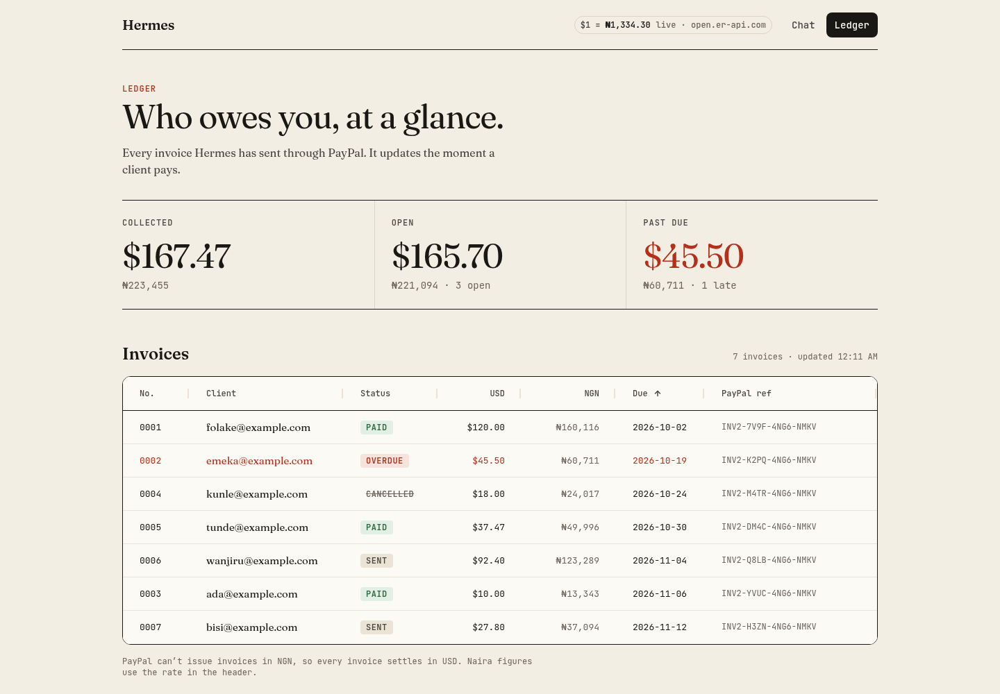
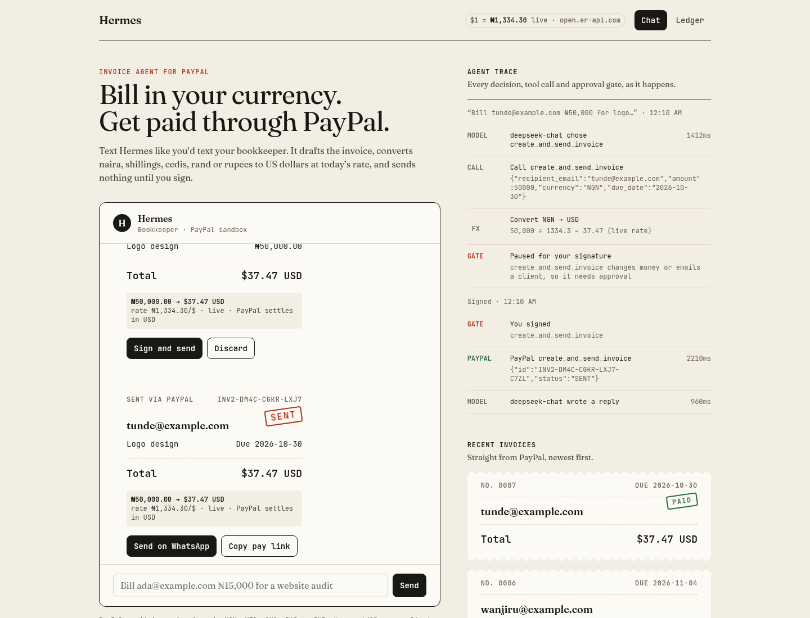
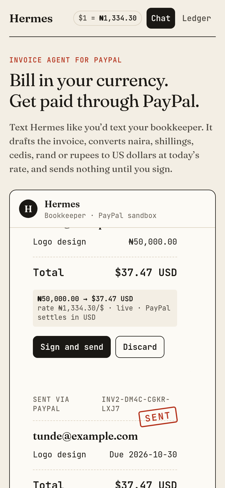

# Hermes Invoice Agent

**Bill in your currency. Get paid through PayPal.**

Chat-first invoicing agent for freelancers and small businesses. Type
`bill tunde@example.com ₦50,000 for logo design due Friday` and Hermes drafts a PayPal invoice,
shows it as a receipt with the currency conversion spelled out, and only creates and emails it after you sign.

### Why the conversion?
PayPal Invoicing can't issue invoices in NGN, KES, GHS, ZAR or INR. Hermes takes the amount in your currency,
converts it to USD at a **live** rate (open.er-api.com, cached 1 h), and puts the original amount and the rate in the
invoice note. Every draft shows a line such as `₦50,000.00 → $37.47 USD · rate ₦1,334.30/$ · live · PayPal settles in USD`.
The header chip shows the current rate and whether it is `live` or `fixed`. If the FX API is down, or you set
`FX_MODE=fixed`, it falls back to `NGN_PER_USD`, `KES_PER_USD`, `GHS_PER_USD`, `ZAR_PER_USD` or `INR_PER_USD`.

## Features
- Create + send invoices, list/search status, send reminders, cancel, cashflow summary (paid / outstanding / overdue)
- Confirmation step before anything that sends an invoice, reminder or cancellation
- ₦ / KSh / GH₵ / R / ₹ amounts converted to USD at a live rate, with a fixed fallback (see above)
- **Agent trace:** every model decision, tool call, FX conversion, approval gate and PayPal call is shown live, with timings
- **Share on WhatsApp:** a sent invoice gets a prefilled wa.me message with the PayPal pay link, plus Copy pay link
- Any OpenAI-compatible LLM: native tool-calling (`AGENT_MODE=tools`) or a JSON-action fallback (`AGENT_MODE=json`) for agents like Hermes that do not honor client-side tools

## Setup
1. Node 22+. `npm install`
2. PayPal: create a sandbox REST app at https://developer.paypal.com/dashboard/applications/sandbox and **enable the Invoicing feature** (and Payouts if needed). Without it Invoicing calls return 403.
3. `cp .env.example .env` and fill in PayPal credentials and the LLM settings.
4. Hermes (optional default): `ssh -i ~/.ssh/hermes_vps -N -L 8642:127.0.0.1:8642 root@<vps>`, put the API key in `LLM_API_KEY`.
   Or use e.g. `LLM_BASE_URL=https://api.deepseek.com/v1 LLM_MODEL=deepseek-chat AGENT_MODE=tools`.
5. `npm run dev` and open http://localhost:3000

## Payment updates
- **Polling fallback (default):** every `POLL_MINUTES` the server re-reads invoices and pushes changes ("Tunde just paid $33.33") to the chat and dashboard over SSE (`GET /api/events`). `POST /api/poll` forces a check.
- **Webhooks:** `POST /api/paypal/webhook` verifies every event with `POST /v1/notifications/verify-webhook-signature` using `PAYPAL_WEBHOOK_ID`. Handles `INVOICING.INVOICE.PAID/CANCELLED/REFUNDED/UPDATED/CREATED/SCHEDULED` and payout item events.
  Registration happens once you have a public HTTPS URL (e.g. after deploying):
  `PUBLIC_URL=https://your-app.example npx tsx scripts/register-webhook.ts`, then set `PAYPAL_WEBHOOK_ID` and restart.
- **Local simulation:** `WEBHOOK_DEV_SKIP_VERIFY=1` (never in production) lets you POST a sample event to the local endpoint.

## Dashboard
`/dashboard` is the ledger: an AG Grid Community table (status, USD, NGN at the live rate, due date, overdue rows in red) under Collected / Open / Past due totals, updated live over SSE. Add `?demo` to either page for sample data.

Design audit: [docs/design-audit.md](docs/design-audit.md). Hackathon pitch: [docs/winning-edge.md](docs/winning-edge.md).

## API
- `POST /api/chat {message, session?}` returns a reply or a `confirm` step (with `fx` and `trace`)
- `POST /api/confirm {session, approve}` executes or declines the pending action (returns `trace`)
- `GET /api/fx` returns current rates, source (`live`/`fixed`), provider and as-of time
- `GET /api/invoices`, `GET /api/cashflow`

## PayPal endpoints used
`POST /v1/oauth2/token`, `POST /v2/invoicing/invoices`, `POST /v2/invoicing/invoices/{id}/send`,
`GET /v2/invoicing/invoices[/{id}]`, `POST /v2/invoicing/search-invoices`, `POST /v2/invoicing/invoices/{id}/remind`,
`POST /v2/invoicing/invoices/{id}/cancel`

## License
MIT
